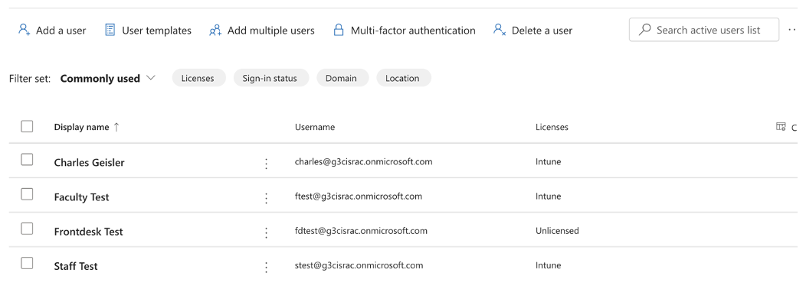
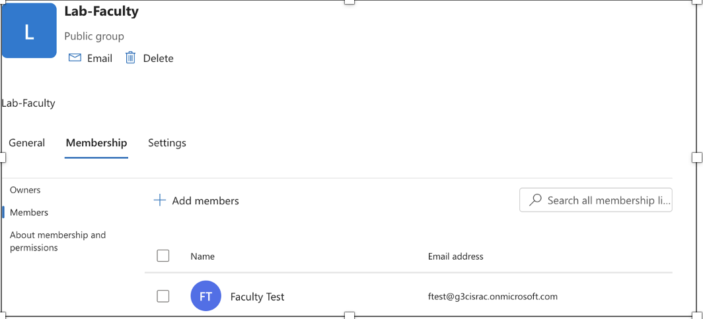
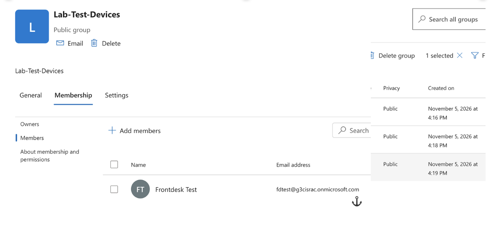
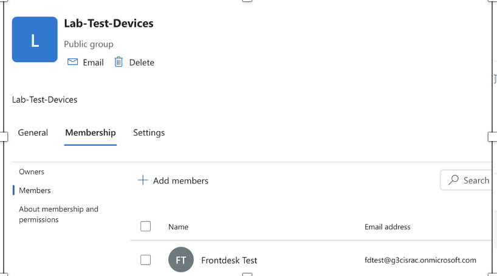

# Microsoft Intune Lab

**Lab goal:** Build a small Microsoft 365 and Intune environment from scratch to practice the core tasks of an endpoint support technician...

## TL;DR

Home lab: Microsoft 365 and Intune administration (users, licensing, device enrollment, compliance and configuration policies, app deployment, troubleshooting).

## Test users

- Created test users: Faculty Test, Front Desk Test, and Staff Test, plus my admin account
- Front Desk Test also received an Intune license (note on the screenshot)

## Create groups and add each user to their corresponding group. 
- Active groups + their members in screenshots:

## Mobility (MIM and WIP) - Enrolling a VM: How to enroll Windows 11

## One issue I ran into: I accidentally originally downloaded Windows 11 Home, not Pro. Home version does not support device mobility policies.
## Register VM with Windows 11; on a Windows 11 Pro or Enterprise VM (the free evaluation ISO works), open Settings > Accounts > Access work or school > Connect > Join this device to Microsoft Entra ID, and signed in as a test user. 

